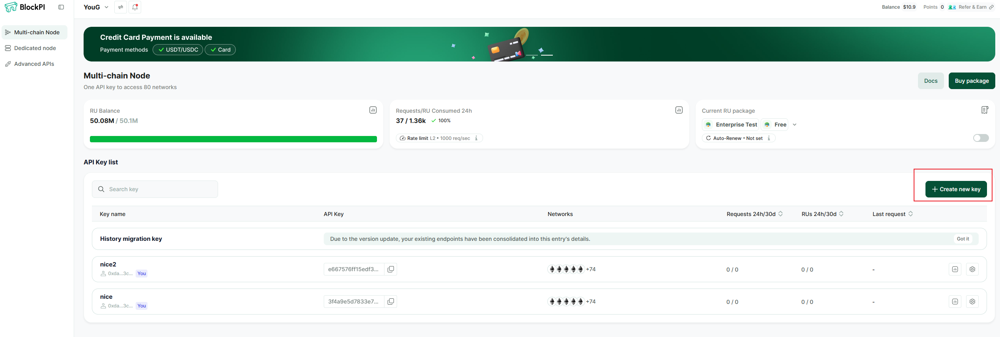

# Generate An API Key


An API key is a simple encrypted string generated by users and verified by BlockPI Hub. It is a pass to use the BlockPI Network service. You will be asked to generate one if you are a new user.&#x20;




Click '+ Create an endpoint' on the Multi-chain Node page.

<figure><figcaption></figcaption></figure>



Choose the blockchain network and input a key name. Or you can just enable all networks. Then click generate.&#x20;

<figure><figcaption></figcaption></figure>



There will be a new endpoint in the Key list.&#x20;

<figure><figcaption></figcaption></figure>




Click into this key's subpage, and you'll see all enabled networks and the relevant settings for this key, including chain configuration, Advanced APIs, basic settings, and security settings.

<figure><figcaption></figcaption></figure>



### Now you can add the RPC endpoint to your Web3 wallet.&#x20;


[wallet-set-up](../wallet-set-up/)


BlockPI Network RPC service is supporting more than 60 blockchain networks.&#x20;


[supported-networks-and-advanced-features.md](../../build/supported-networks-and-advanced-features.md)

